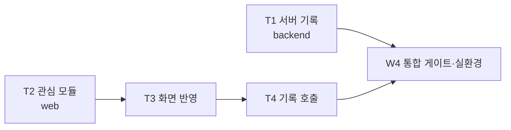

# 개인화 랭킹(관심 가중치) 구현 계획

> **작업자에게:** 이 계획은 아래 "실행 프롬프트" 를 터미널에 붙여넣어 태스크 단위로 실행한다. 단계는 체크박스(`- [ ]`)로 추적한다.

**목표:** 사용자의 검색·조회 기록으로 관심 프로필을 만들고, 그 관심에 맞는 지역의 종합 점수에 가산점을 더해 티어·홈·상세·마이페이지·히트맵의 점수·등급·순위를 사용자마다 다르게 보여 준다. 기록은 서버 `user_event` 표에도 쌓는다.

**구조:** 관심 계산은 웹의 순수 함수 모듈 `src/features/interest/` 하나에 모은다(기록 저장, 프로필, 가산점, 등급 보정). 화면들은 이 모듈의 `useBoost()` 가 주는 함수 하나만 받아 기존 등급 계산에 넘긴다. 백엔드는 `POST /api/events` 로 기록만 받고, 쌓인 시군구 조회로 `viewCount` 를 채운다.

**기술:** 웹 React 19 · TypeScript · Vitest · Testing Library (pnpm), 백엔드 Django REST Framework · pytest · PostgreSQL(Supabase).

**설계:** `workation-web/docs/superpowers/specs/2026-11-15-개인화-랭킹-design.md` (같은 브랜치에 있다. 작업자는 계획과 설계를 함께 읽는다)

## 완료 조건

- 웹 `feat/personalized-ranking` 에서 `pnpm test`, `pnpm exec tsc -b`, `pnpm lint`, `pnpm format:check`, `E2E_PORT=5183 pnpm e2e` 가 모두 통과한다.
- 백엔드 `feat/user-event` 에서 `uv run pytest -q`, `uv run ruff check .`, `uv run ruff format --check .` 가 모두 통과한다.
- W4 4번의 실환경 확인 항목이 모두 참이다 (검색·조회 뒤 종합 순위·등급 변화, 기본 등급 아래로 내려간 지역 없음, 상세 화면 등급이 티어표와 같음, `user_event` 행과 `viewCount`).
- 사용자가 실제 화면을 보고 확인했다.

## 비범위

- 로그인, `anon_id` 와 `user_id` 연결 (다음 작업).
- 서버에서 개인화 점수 계산, 다른 사용자 행동을 합친 랭킹 (`viewCount` 제외).
- W-05 비교, 지표 하나 보기, 세부 지표 칩, 지도 탐색(W-09) 화면 순서.
- 백엔드 `POST /api/regions/{id}/view` 정리 (웹이 부르지 않게만 한다).
- Supabase 에 migration 적용 (사용자 몫).

## 전역 제약

- 화면에 "추천", "관심 반영" 같은 표시나 켜고 끄는 버튼을 두지 않는다 (설계 2절).
- 가산점은 **종합 점수에만** 붙는다. 지표별 점수·세부 등급 칩·지표 하나 보기(`tab === 'metric'`)·W-05 비교(`compare/rank.ts`)는 바꾸지 않는다 (설계 5-4, 8절).
- 개인 등급은 기본 등급과 같거나 최대 한 단계 위다 (설계 8절).
- 기록이 없으면 모든 화면이 지금과 똑같다 (가산점 0).
- localStorage 읽기·쓰기 실패, 서버 전송 실패는 화면을 깨지 않는다 (try/catch, 실패 무시).
- 공유 Supabase 스키마는 SQL 파일만 만들고 적용은 사용자가 한다.
- mock 모드(`VITE_USE_MOCK=true`)에서는 서버 전송만 생략하고 개인화는 동작한다.
- 주석·커밋 메시지는 한국어, 산문에 대시 기호를 쓰지 않는다. 팀 저장소 규칙: Conventional Commits (`feat:`, `test:`, `docs:`).

## 리뷰 초점 (어떤 태스크 테스트도 직접 겨누지 않아 사용자를 물 가능성이 큰 것)

1. **다른 사용자의 공유 링크로 들어온 경우**: URL 의 `q` 자동 파싱은 기록되지 않아야 한다. T4 테스트 `entry parse does not record` 가 고정한다.
2. **localStorage 가 막힌 브라우저(사파리 사생활 보호 등)**: 예외 없이 가산점 0. T2 테스트 `storage failure yields no events and no throw` 가 고정한다.
3. **같은 지역 새로고침 반복**: 30분 안 반복 조회는 한 번만 친다. T2 테스트 `dedups same target within 30 minutes` 가 고정한다.
4. **관심 없는 지역의 등급 하락**: 다른 지역이 올라가도 기본 등급 아래로 내려가지 않는다. T2 테스트 `never drops below base grade` 가 고정한다.
5. **탭 두 개에서 동시에 기록**: `storage` 이벤트로 다른 탭 기록도 반영된다. T2 테스트 `useBoost reacts to storage event` 가 고정한다.

---

## 실행 모델과 모델 배분

메인 세션은 오케스트레이터(스폰·리뷰·통합·실환경 검증)로 남고, 각 태스크는 실행 프롬프트를 붙여넣은 별도 Claude Code 세션이 구현한다. 두 저장소에 프로젝트 지침 파일(CLAUDE.md)이 없어 전역 정의를 쓴다: 상위 = `claude-opus-5-5` 추론 high, 표준 = `claude-opus-5-5` 추론 medium.

| 태스크                  | 저장소  | 모델 | 사유                                                          |
| ----------------------- | ------- | ---- | ------------------------------------------------------------- |
| T1 서버 기록            | backend | 표준 | 표·검증·집계가 계획서에 고정돼 있다                           |
| T2 관심 모듈(공유 계약) | web     | 상위 | 가산점·등급 보정 계산과 다른 태스크가 쓰는 공유 타입을 만든다 |
| T3 화면 반영            | web     | 표준 | T2 함수를 기존 계산에 끼우는 작업                             |
| T4 기록 호출            | web     | 표준 | 화면 네 곳에서 T2 함수를 부른다                               |

## 웨이브 구성



| 웨이브 | 터미널         | 태스크                  | 선행    | 이유                                                                   |
| ------ | -------------- | ----------------------- | ------- | ---------------------------------------------------------------------- |
| W1     | A              | T1                      | 없음    | 백엔드만 만진다                                                        |
| W1     | B              | T2                      | 없음    | 웹 새 폴더만 만든다. T1 과 파일이 겹치지 않는다                        |
| W2     | C              | T3                      | T2 통합 | T2 의 `BoostFn` · `personalize` 를 쓴다                                |
| W3     | D              | T4                      | T3 통합 | T3 과 `RegionDetailPage.tsx` · `DongProfilePage.tsx` 를 함께 고쳐 순차 |
| W4     | 오케스트레이터 | 통합 게이트·실환경 검증 | T1, T4  | 공유 DB 를 쓰므로 직렬                                                 |

**통합 브랜치**

- 웹: `feat/personalized-ranking`. 오케스트레이터가 설계 수정분과 계획서를 `docs/personalized-ranking` 에 함께 커밋(`docs: 개인화 랭킹 구현 계획`)한 뒤 그 커밋에서 만든다. T2·T3·T4 는 여기서 브랜치를 따고 여기로 머지된다.
- 백엔드: `feat/user-event`. `origin/main`(`38af798`)에서 따고 T1 이 직접 쓴다.
- 통합 대장: `workation-web/docs/superpowers/plans/2026-11-15-개인화-랭킹-ledger.tsv` (태스크명 TAB 통합 SHA). 통합할 때마다 오케스트레이터가 문서 커밋으로 남긴다.

**사람이 터미널을 열기 전 확인 2줄** (웹 저장소 루트에서)

```bash
git -C /Users/doo._.hyun/Study/Project/Workcation/repos/workation-web log --oneline -1 feat/personalized-ranking
git -C /Users/doo._.hyun/Study/Project/Workcation/repos/workation-web status --short
```

---

## 공유 계약 (T2 가 만들고 T3·T4 가 쓴다)

`src/features/interest/types.ts` 는 아래 그대로 만든다. 한 글자라도 바꾸려면 멈추고 보고한다.

```ts
import type { MonthParam } from '@/features/metric/month'
import type { MetricScores, PresetKey, Weights } from '@/features/metric/types'
import type { Terrain } from '@/features/popular/types'

export type InterestKind = 'search' | 'region_view' | 'dong_view'

/** 조회한 순간 화면이 가진 그 지역 값 (설계 8절 스냅숏) */
export type ViewSnapshot = { month: MonthParam; scores: MetricScores; terrain: Terrain[] }

export type SearchPayload = {
  q: string
  preset: PresetKey | null
  terrain: Terrain[]
  month: MonthParam | null
}
export type ViewPayload = { sigunguId: string | null; snapshot: ViewSnapshot | null }

/** 브라우저 기록 한 건. 서버 POST /api/events 본문은 { anonId, kind, target, payload } */
export type InterestEvent =
  | { kind: 'search'; target: null; payload: SearchPayload; at: number }
  | { kind: 'region_view' | 'dong_view'; target: string; payload: ViewPayload; at: number }

/** recordInterest 입력. at 은 기록 함수가 채운다 */
export type InterestInput =
  | { kind: 'search'; target: null; payload: SearchPayload }
  | { kind: 'region_view' | 'dong_view'; target: string; payload: ViewPayload }

export type InterestProfile = {
  metric: Weights // 지표 관심 (감쇠 가중 합)
  terrain: Record<Terrain, number>
  place: Record<string, number> // 시군구 5자리 · 행정동 10자리 코드 → 감쇠 가중 합
  strength: number // 모든 기록의 감쇠 가중 합
}

/** 가산점 계산 대상. TierItem · PopularRegion · FavoriteRegion 을 이 모양으로 넘긴다 */
export type BoostUnit = {
  id: string
  sigunguId?: string
  scores: MetricScores
  terrain?: Terrain[]
}
export type BoostFn = (unit: BoostUnit) => number
```

`src/features/interest/index.ts` 가 내보내는 것 (T3·T4 는 이 경로로만 가져온다)

| 이름             | 시그니처                                                                                                                                                                                                                                                                                                                                                                                                           |
| ---------------- | ------------------------------------------------------------------------------------------------------------------------------------------------------------------------------------------------------------------------------------------------------------------------------------------------------------------------------------------------------------------------------------------------------------------ |
| 타입             | 위 `types.ts` 전부                                                                                                                                                                                                                                                                                                                                                                                                 |
| `NO_BOOST`       | `BoostFn` (항상 0)                                                                                                                                                                                                                                                                                                                                                                                                 |
| `personalize`    | `(base: number[], boost: number[]) => { score: number; grade: Grade }[]`                                                                                                                                                                                                                                                                                                                                           |
| `useBoost`       | `(opts?: { live?: boolean; freezeKey?: string }) => BoostFn`. 기록이 없으면 `NO_BOOST` 와 같은 결과. `live` 기본 true 는 기록이 바뀌면 다시 계산하고, `live: false` 는 처음 그릴 때의 기록으로 고정하되 `freezeKey` 가 바뀌면 그 시점 기록으로 다시 고정한다 (같은 라우트 안 /dongs/A → /dongs/B 이동은 컴포넌트가 재사용되기 때문) (상세 화면이 자기 조회 기록 때문에 보는 도중 점수·순위가 바뀌어 깜빡이지 않게) |
| `recordInterest` | `(input: InterestInput) => void` (절대 throw 하지 않는다)                                                                                                                                                                                                                                                                                                                                                          |

서버 계약 `POST /api/events`

- 본문: `{"anonId": "<uuid v4>", "kind": "search" | "region_view" | "dong_view", "target": <문자열 또는 null>, "payload": <객체 또는 null>}`
- `target` 규칙: `search` 는 `null`, `region_view` 는 숫자 5자리, `dong_view` 는 숫자 10자리.
- `payload` 는 객체 또는 `null`. 크기는 `len(json.dumps(payload, ensure_ascii=False, separators=(",", ":")).encode())` 가 2048 이하.
- 성공 204, 규칙 위반 400, 한도 초과 429. 헤더는 기존 `api<T>()` 와 같이 `Content-Type: application/json`, `X-Requested-With: workation-web`.

---

## Task 1: 서버 기록 `user_event` (backend)

**Files:**

- Create: `db/migrations/20261115_user-event.sql`
- Modify: `db/schema.sql` (끝에 같은 DDL 추가, RLS 줄은 기존 `ALTER TABLE ... ENABLE ROW LEVEL SECURITY` 묶음에 추가)
- Modify: `db/README.md` (적용 이력 표에 한 줄, Supabase 적용 칸 "미적용")
- Create: `webapi/models.py`
- Modify: `webapi/views.py` (`events` 뷰 추가, `popular` 의 `viewCount`)
- Modify: `webapi/urls.py` (`path("events", views.events, name="web-events")`, `re_path` 위에)
- Modify: `config/settings.py` (`DEFAULT_THROTTLE_RATES` 에 두 키)
- Modify: `tests/test_cache.py` (`test_test_settings_use_locmem_and_throttle_rates` 의 기대 딕셔너리에 `"events_burst": "60/min"`, `"events_day": "2000/day"` 추가)
- Test: `tests/test_events.py` (새 파일)

**Interfaces:**

- Consumes: 없음
- Produces: 위 "서버 계약" 의 `POST /api/events`, `GET /api/regions/popular` 의 `viewCount` (최근 30일 `region_view` 의 서로 다른 `anon_id` 수)

DDL (migration 과 schema.sql 에 같은 문장, migration 은 `IF NOT EXISTS` 로 재실행 안전):

```sql
CREATE TABLE IF NOT EXISTS user_event (
  id          BIGSERIAL    PRIMARY KEY,
  anon_id     UUID         NOT NULL,
  user_id     UUID         REFERENCES app_user (user_id) ON DELETE SET NULL,
  kind        VARCHAR(16)  NOT NULL,
  target      VARCHAR(10),
  payload     JSONB,
  created_at  TIMESTAMPTZ  NOT NULL DEFAULT now(),
  CHECK (kind IN ('search', 'region_view', 'dong_view'))
);
CREATE INDEX IF NOT EXISTS user_event_anon_idx   ON user_event (anon_id, created_at);
CREATE INDEX IF NOT EXISTS user_event_target_idx ON user_event (kind, target, created_at);
ALTER TABLE user_event ENABLE ROW LEVEL SECURITY;
COMMENT ON TABLE  user_event         IS '사용자 행동 기록 (개인화 랭킹). 계산은 웹, 서버는 기록과 viewCount 집계';
COMMENT ON COLUMN user_event.anon_id IS '브라우저 익명 ID (localStorage)';
COMMENT ON COLUMN user_event.user_id IS '로그인 뒤 연결. 지금은 NULL';
COMMENT ON COLUMN user_event.target  IS 'region_view: 시군구 코드 5자리, dong_view: 행정동 코드 10자리, search: NULL';
COMMENT ON COLUMN user_event.payload IS 'search: {q, preset, terrain, month}, view: {sigunguId, snapshot}';
```

`viewCount` 집계 쿼리 (`popular` 에서 한 번 실행해 `{sigungu_code: count}` 로 쓴다):

```sql
SELECT target, COUNT(DISTINCT anon_id)
FROM user_event
WHERE kind = 'region_view' AND created_at >= now() - interval '30 days'
GROUP BY target
```

한도 값: `"events_burst": "60/min"`, `"events_day": "2000/day"`. 근거: 화면 이동마다 많아야 한 건이라 사람이 1분에 60건을 넘기기 어렵고, 하루 2000건이면 하루 종일 둘러봐도 닿지 않는다. 막는 대상은 스크립트 남용이다. 클래스는 `explore/views.py` 의 `AskBurstThrottle` 처럼 `AnonRateThrottle` 을 상속해 `scope` 만 바꾼다.

- [ ] **Step 1: 실패하는 테스트 작성** `tests/test_events.py`. 픽스처는 `from tests.test_api import data  # noqa: F401` 를 재사용하고, 유효한 익명 ID 는 `"9b2f6c1e-3d4a-4c5b-8e7f-0a1b2c3d4e5f"`.

```python
def test_region_view_saved(client, data):  # noqa: F811
    r = client.post("/api/events", {"anonId": AID, "kind": "region_view", "target": "51820",
                    "payload": {"sigunguId": None, "snapshot": None}}, content_type="application/json")
    assert r.status_code == 204
    row = UserEvent.objects.get()
    assert (str(row.anon_id), row.kind, row.target) == (AID, "region_view", "51820")
    assert row.payload == {"sigunguId": None, "snapshot": None} and row.user_id is None

def test_dong_view_ten_digits_ok(client, data): ...        # target "5182025300" → 204
def test_search_target_must_be_null(client, data): ...    # kind search, target "51820" → 400, 행 0개
def test_search_saved_with_null_target(client, data): ... # target None, payload {"q": "바닷가"} → 204
def test_unknown_kind_rejected(client, data): ...          # kind "click" → 400
def test_bad_anon_id_rejected(client, data): ...           # anonId "abc" → 400
def test_region_target_must_be_five_digits(client, data): ...  # "5182" → 400
def test_payload_too_large_rejected(client, data): ...     # {"q": "가" * 1000} (UTF-8 3000바이트) → 400
def test_payload_must_be_object_or_null(client, data): ... # payload [1, 2] → 400
def test_popular_view_count(client, data): ...
    # 51820 에 region_view: 익명 A 2건, 익명 B 1건, 익명 C 1건(created_at 을 31일 전으로 UPDATE)
    # → items 중 id "51820" 의 viewCount == 2, 다른 시군구는 0
def test_events_throttled(client, data, monkeypatch): ...
    # DRF 는 한도 표를 클래스 로드 때 묶어 두므로 settings 를 바꾸지 않는다.
    # monkeypatch.setattr(EventsBurstThrottle, "rate", "2/min") 와 django.core.cache.cache.clear() 뒤
    # 유효한 요청 세 번: 앞의 두 번 204, 세 번째 429
```

- [ ] **Step 2: 실패 확인** `uv run pytest tests/test_events.py -q` → 테이블·URL 이 없어 실패.
- [ ] **Step 3: DDL** migration 파일, `schema.sql`, `db/README.md` 적용 이력 한 줄 (`migrations/20261115_user-event.sql` | 개인화 랭킹 행동 기록 `user_event` | 미적용).
- [ ] **Step 4: 모델** `webapi/models.py` 에 `UserEvent` (`managed = False`, `db_table = "user_event"`, 필드는 DDL 그대로, `user_id` 는 `UUIDField(null=True)` 로 둬 `app_user` 모델 의존을 만들지 않는다).
- [ ] **Step 5: 뷰** `events(request)`: `@api_view(["POST"])` + `@throttle_classes([EventsBurstThrottle, EventsDayThrottle])`. 검증 실패는 기존 `bad_request()` 로 400. 성공 시 `Response(status=204)`.
- [ ] **Step 6: viewCount** `popular` 에서 위 집계 쿼리 결과로 `"viewCount": counts.get(r.sigungu_code, 0)`. `favoriteCount` 는 0 그대로.
- [ ] **Step 7: 통과 확인** `uv run pytest -q` 전체 통과, `uv run ruff check . && uv run ruff format --check .` 통과.
- [ ] **Step 8: 커밋** `feat: 개인화 랭킹 행동 기록 API (user_event · POST /api/events · viewCount)`

---

## Task 2: 관심 모듈 `src/features/interest/` (web, 공유 계약)

**Files:**

- Create: `src/features/interest/types.ts` (위 공유 계약 그대로)
- Create: `src/features/interest/constants.ts`, `profile.ts`, `personalize.ts`, `store.ts`, `record.ts`, `useBoost.ts`, `index.ts`
- Test: `src/features/interest/profile.test.ts`, `personalize.test.ts`, `store.test.ts`, `record.test.ts`, `useBoost.test.tsx`

**Interfaces:**

- Consumes: `composite`, `toGrades` (`@/features/metric/score`), `PRESET_WEIGHTS` (`@/features/metric/constants`), `GRADES`, `METRIC_KEYS` (`@/features/metric/types`), `isMock` (`@/lib/mock`), `API_BASE_URL` (`@/lib/api`)
- Produces: 위 `index.ts` 표 전부

**상수와 근거** (`constants.ts`, 이름·값 그대로):

| 이름             | 값                                          | 근거                                                                                                                |
| ---------------- | ------------------------------------------- | ------------------------------------------------------------------------------------------------------------------- |
| `HALF_LIFE_DAYS` | 7                                           | 일주일 지나면 절반, 한 달이면 약 1/16. "지금 관심" 이 드러나게 (설계 5-3 기본값)                                    |
| `MAX_AGE_DAYS`   | 60                                          | 60일 지난 기록은 무게가 약 1/380 이라 버려도 결과가 같다                                                            |
| `MAX_EVENTS`     | 300                                         | 한 건 약 300바이트, 300건이면 약 90KB 로 localStorage 한도(약 5MB) 안에서 여유                                      |
| `DEDUP_MS`       | `30 * 60 * 1000`                            | 새로고침·뒤로 가기 반복을 한 번으로 (설계 5-2 예시)                                                                 |
| `BOOST_CAP`      | 15                                          | 100점 척도 상한 (설계 5-4)                                                                                          |
| `MIX`            | `{ metric: 0.2, terrain: 0.1, place: 0.7 }` | T5 에서 변경(처음 0.5/0.2/0.3). 본 곳에 효과를 모은다. 근거: `../specs/2026-11-15-개인화-랭킹-가산점-근거.md` 4-2절 |
| `PLACE_SAT`      | 2                                           | T5 에서 추가. 장소 일치도 `1 - exp(-pw / 2)`, 조회 1번에 0.39. 근거 문서 4-3절                                      |
| `VIEW_SIGNAL`    | 0.5                                         | 조회는 검색보다 약한 의사 표시라 지표·지형 관심을 절반만 더한다                                                     |
| `SIGUNGU_SHARE`  | 0.5                                         | 행정동 조회는 소속 시군구 관심으로 절반 친다 (설계 5-2)                                                             |
| `STORAGE_KEY`    | `'workation.interest.v1'`                   | `{ anonId: string; events: InterestEvent[] }` 저장                                                                  |

**계산 로직** (판단이 갈리는 부분이라 그대로 구현한다. `profile.ts`). 아래 `boostFor` 는 T2 에서 처음 구현한 식이다.
실데이터 조사 뒤 T5 에서 지형·지표 일치도를 세기 대비 몫으로 바꾸고(`terrain[t] / strength`, `× min(1, metricSum / strength)`),
장소 포화를 `PLACE_SAT` 로 늦추고, `personalize` 가 표시 점수를 100 에서 자르게 고쳤다. 근거와 수치는
`../specs/2026-11-15-개인화-랭킹-가산점-근거.md`, 현재 식은 `src/features/interest/profile.ts` 가 기준이다.

```ts
const DAY = 86_400_000
export const decay = (at: number, now: number) => 0.5 ** ((now - at) / (HALF_LIFE_DAYS * DAY))

export function buildProfile(events: InterestEvent[], now: number): InterestProfile {
  // metric · terrain 0 으로 시작, place {}, strength 0
  // 각 기록 e 에 대해 w = decay(e.at, now)
  //   strength += w
  //   search: preset 이 'quiet' | 'lively' 면 PRESET_WEIGHTS[preset] 를 합이 1 이 되게 나눠 w 를 곱해 metric 에 더함
  //           terrain 의 각 값 t 에 terrain[t] += w
  //   view(region_view · dong_view):
  //           place[e.target] += w
  //           dong_view 이고 payload.sigunguId 가 있으면 place[sigunguId] += w * SIGUNGU_SHARE
  //           snapshot 이 있으면: 지표마다 a_k = max(0, score_k - 50) / 50, 합이 0 보다 크면 합이 1 이 되게 나눠
  //             w * VIEW_SIGNAL 를 곱해 metric 에 더함. snapshot.terrain 의 각 t 에 terrain[t] += w * VIEW_SIGNAL
}

export function boostFor(p: InterestProfile, u: BoostUnit): number {
  if (p.strength === 0) return 0
  const s = 1 - Math.exp(-p.strength / 2) // 기록 1건 0.39, 3건 0.78: 한 번 본 것으로 상한까지 가지 않게
  const metricSum = METRIC_KEYS.reduce((a, k) => a + p.metric[k], 0)
  const metricMatch = metricSum > 0 ? composite(u.scores, p.metric) / 100 : 0
  const tMax = Math.max(...Object.values(p.terrain))
  const terrainMatch =
    tMax > 0 && u.terrain?.length ? Math.max(...u.terrain.map((t) => p.terrain[t] / tMax)) : 0
  const pw = (p.place[u.id] ?? 0) + (u.sigunguId ? (p.place[u.sigunguId] ?? 0) * SIGUNGU_SHARE : 0)
  const placeMatch = 1 - Math.exp(-pw)
  return (
    BOOST_CAP *
    (MIX.metric * s * metricMatch + MIX.terrain * s * terrainMatch + MIX.place * placeMatch)
  )
}
```

**등급 보정** (`personalize.ts`, 그대로 구현):

```ts
/** 개인 점수 = base + boost. 등급은 toGrades(개인 점수) 를 기본 등급과 그 한 단계 위 사이로 묶는다 */
export function personalize(base: number[], boost: number[]): { score: number; grade: Grade }[] {
  const personal = base.map((b, i) => b + (boost[i] ?? 0))
  const baseG = toGrades(base)
  const persG = toGrades(personal)
  return personal.map((score, i) => {
    const b = GRADES.indexOf(baseG[i]) // S=0 … C=3
    const p = GRADES.indexOf(persG[i])
    return { score, grade: GRADES[Math.min(b, Math.max(b - 1, p))] }
  })
}
```

**저장·기록** (`store.ts`, `record.ts`):

- `store.ts`: `getAnonId(): string` (없으면 `crypto.randomUUID()` 로 만들어 저장, 저장 실패 시 메모리 값), `getEvents(): InterestEvent[]` (`MAX_AGE_DAYS` 지난 것 제외, 실패 시 `[]`), `appendEvent(e: InterestEvent): void` (마지막 300건 유지), `subscribe(cb: () => void): () => void` (같은 탭 `appendEvent` 와 다른 탭 `window` `storage` 이벤트(키 `STORAGE_KEY`) 모두 알림), `getVersion(): number` (`useSyncExternalStore` 스냅숏용, 변경마다 증가).
- `record.ts`: `recordInterest(input)`: 같은 `kind`·`target` 의 마지막 기록이 `DEDUP_MS` 안이면 무시(search 는 `payload.q` 까지 같을 때 무시). 아니면 `appendEvent({ ...input, at: Date.now() })` 하고, `isMock` 이 아니면 `fetch(`${API_BASE_URL}/api/events`, { method: 'POST', keepalive: true, credentials: 'include', headers: { 'Content-Type': 'application/json', 'X-Requested-With': 'workation-web' }, body: JSON.stringify({ anonId, kind, target, payload }) })` 를 기다리지 않고 `.catch(() => {})`. 함수 전체를 try/catch 로 감싼다.
- `useBoost.ts`: `useSyncExternalStore(subscribe, getVersion)` 로 버전을 구독하고, 버전이 바뀔 때만 `buildProfile(getEvents(), Date.now())` 을 다시 만들어 `(u) => boostFor(profile, u)` 를 `useMemo` 로 돌려준다. `live: false` 면 첫 렌더의 버전을 고정해 그 버전의 프로필을 쓰고, `freezeKey` 가 이전 렌더와 달라지면 그 렌더의 현재 버전으로 다시 고정한다 (이전 key 를 `useRef` 로 비교).

- [ ] **Step 1: 실패하는 테스트 작성.** 공통: `NOW = Date.UTC(2026, 10, 15)`, 점수 픽스처 `HIGH = { quiet: 100, crowd: 100, peer: 100, overnight: 100, vibe: 100 }`, `QUIET = { quiet: 95, crowd: 90, peer: 30, overnight: 60, vibe: 10 }`, `LIVELY = { quiet: 10, crowd: 20, peer: 90, overnight: 60, vibe: 95 }`.

`profile.test.ts`

```ts
test('no events gives zero boost', () => {
  expect(boostFor(buildProfile([], NOW), { id: '51150', scores: HIGH, terrain: ['coast'] })).toBe(0)
})
test('boost never exceeds cap', () => {
  // 같은 시각 search(preset quiet, terrain coast) 25건 + 51150 region_view(snapshot HIGH, coast) 25건
  const b = boostFor(buildProfile(events, NOW), { id: '51150', scores: HIGH, terrain: ['coast'] })
  expect(b).toBeLessThanOrEqual(15)
  expect(b).toBeGreaterThan(14)
})
test('weight halves after half life', () => {
  const p = buildProfile([viewAt(NOW - 7 * DAY)], NOW)
  expect(p.strength).toBeCloseTo(0.5, 6)
})
test('quiet coast search favors quiet coast region', () => {
  const p = buildProfile([search({ preset: 'quiet', terrain: ['coast'] }, NOW)], NOW)
  expect(boostFor(p, { id: 'a', scores: QUIET, terrain: ['coast'] })).toBeGreaterThan(
    boostFor(p, { id: 'b', scores: LIVELY, terrain: ['city'] }),
  )
})
test('dong view boosts that dong, then siblings, then others', () => {
  const p = buildProfile([dongView('5115066500', '51150', null, NOW)], NOW)
  const same = { scores: QUIET, terrain: ['coast'] as Terrain[] }
  const x = boostFor(p, { id: '5115066500', sigunguId: '51150', ...same })
  const sib = boostFor(p, { id: '5115025000', sigunguId: '51150', ...same })
  const other = boostFor(p, { id: '5182025300', sigunguId: '51820', ...same })
  expect(x).toBeGreaterThan(sib)
  expect(sib).toBeGreaterThan(other)
})
test('view without snapshot adds place only', () => {
  const p = buildProfile([regionView('51150', null, NOW)], NOW)
  expect(Object.values(p.metric).every((v) => v === 0)).toBe(true)
  expect(p.place['51150']).toBeCloseTo(1, 6)
})
```

`personalize.test.ts` (기본 점수 8개: `BASE = [90, 80, 70, 60, 50, 40, 30, 20]` → 기본 등급 S S A A B B C C)

```ts
test('zero boost keeps base scores and grades', () => {
  const r = personalize(
    BASE,
    BASE.map(() => 0),
  )
  expect(r.map((x) => x.score)).toEqual(BASE)
  expect(r.map((x) => x.grade)).toEqual(toGrades(BASE))
})
test('climbs at most one grade', () => {
  const boost = BASE.map((_, i) => (i === 7 ? 100 : 0))
  const r = personalize(BASE, boost)
  expect(r[7].grade).toBe('B')
  expect(r[7].score).toBe(120)
})
test('never drops below base grade', () => {
  const boost = BASE.map((_, i) => (i === 0 ? 0 : 100))
  expect(personalize(BASE, boost)[0].grade).toBe('S')
})
```

테스트 도우미 (`profile.test.ts` 안에 둔다): `search(p: Partial<SearchPayload>, at: number): InterestEvent` (빠진 값은 `q: ''`, `preset: null`, `terrain: []`, `month: null`), `regionView(id: string, snapshot: ViewSnapshot | null, at: number)`, `dongView(id: string, sigunguId: string, snapshot: ViewSnapshot | null, at: number)`, `viewAt(at: number)` = `regionView('51150', null, at)`. `DAY = 86_400_000`.

테스트 이름은 리뷰 초점이 이름으로 참조하므로 **적힌 그대로** 쓴다 (저장소의 다른 테스트가 한국어 이름이어도 바꾸지 않는다). `test` 대신 `it` 을 써도 된다.

`store.test.ts` · `record.test.ts` · `useBoost.test.tsx` 의 테스트 이름과 단언 (괄호 안이 파일):

- `anon id is stable uuid` (store): 두 번 부른 `getAnonId()` 가 같고 `/^[0-9a-f-]{36}$/` 에 맞는다.
- `keeps last 300 events` (store): `appendEvent` 301번 뒤 `getEvents().length === 300`, 첫 기록의 `at` 이 두 번째로 넣은 값.
- `drops events older than 60 days` (store): 61일 전 기록은 `getEvents()` 에 없다.
- `storage failure yields no events and no throw` (record): `vi.spyOn(Storage.prototype, 'getItem')` · `setItem` 이 throw 하게 한 뒤 `recordInterest(regionViewInput)` 가 throw 하지 않고 `getEvents()` 가 `[]`.
- `dedups same target within 30 minutes` (record): `vi.setSystemTime` 으로 같은 `region_view 51150` 을 0분, 29분에 기록하면 1건, 31분에 한 번 더 하면 2건.
- `posts event to server` (record): `isMock` 을 false 로 mock, `fetch` 를 `vi.fn().mockResolvedValue(new Response(null, { status: 204 }))` 로 두고 기록하면 첫 인자가 `'/api/events'` 로 끝나고, `JSON.parse(init.body)` 가 `{ anonId: getAnonId(), kind: 'region_view', target: '51150', payload }` 와 같다.
- `server failure is swallowed` (record): `fetch` 가 reject 해도 `recordInterest` 가 throw 하지 않고 로컬 기록은 1건.
- `skips server in mock mode` (record): `isMock` true 면 `fetch` 가 불리지 않고 로컬 기록은 1건.
- `useBoost returns zero without events` (useBoost): `renderHook(useBoost)` 결과에 아무 unit 을 넣어도 0.
- `useBoost updates after record` (useBoost): `act(() => recordInterest(regionView 51150))` 뒤 `result.current({ id: '51150', scores: QUIET })` > 0.
- `useBoost reacts to storage event` (useBoost): localStorage 에 직접 기록을 쓰고 `window.dispatchEvent(new StorageEvent('storage', { key: STORAGE_KEY }))` 하면 0 보다 커진다.

- `useBoost live false stays fixed` (useBoost): `renderHook(() => useBoost({ live: false }))` 뒤 `act(() => recordInterest(regionView 51150))` 해도 `result.current({ id: '51150', scores: QUIET })` 가 0.
- `useBoost refreezes on key change` (useBoost): `renderHook(({ k }) => useBoost({ live: false, freezeKey: k }), { initialProps: { k: 'A' } })` 뒤 `regionView 51150` 기록, 아직 0. `rerender({ k: 'B' })` 하면 `result.current({ id: '51150', scores: QUIET })` > 0.

`record.test.ts` 에서 `isMock` 을 바꾸는 방법 (모듈 상수이고 테스트 환경은 `VITE_USE_MOCK: 'true'`):

```ts
const m = vi.hoisted(() => ({ isMock: false }))
vi.mock('@/lib/mock', () => ({
  get isMock() {
    return m.isMock
  },
}))
// posts event to server: m.isMock = false, skips server in mock mode: m.isMock = true
```

각 테스트 전후 `localStorage.clear()`, `vi.useRealTimers()`.

- [ ] **Step 2: 실패 확인** `pnpm vitest run src/features/interest` → 모듈이 없어 실패.
- [ ] **Step 3: 구현** 위 계약·상수·로직대로 파일 8개.
- [ ] **Step 4: 통과 확인** `pnpm vitest run src/features/interest` 통과, `pnpm test` 전체 통과, `pnpm exec tsc -b` 오류 0, `pnpm lint` 와 `pnpm format:check` 통과.
- [ ] **Step 5: 커밋** `feat: 개인화 랭킹 관심 모듈 (기록 · 프로필 · 가산점 · 등급 보정)`

---

## Task 3: 화면 반영 (web)

**Files:**

- Modify: `src/features/tier/buildTiers.ts`, `src/features/region/rank.ts`, `src/features/popular/sort.ts`, `src/features/popular/components/PopularRegions.tsx`, `src/features/heatmap/heat.ts`, `src/features/heatmap/useHeatEntries.ts`, `src/features/me/components/FavoriteRegions.tsx`, `src/pages/TierPage.tsx`, `src/pages/RegionDetailPage.tsx` (rankIn 호출 한 줄), `src/pages/DongProfilePage.tsx` (`sggRank` 의 rankIn 호출 한 줄)
- Test: 기존 파일에 케이스 추가 `src/features/tier/buildTiers.test.ts`, `src/features/popular/sort.test.ts`, `src/features/region/rank.test.ts`, `src/features/heatmap/heat.test.ts`

**Interfaces:**

- Consumes: `BoostFn`, `BoostUnit`, `NO_BOOST`, `personalize`, `useBoost` (`@/features/interest`)
- Produces:
  - `buildTiers(items: TierItem[], mode: TierMode, boost: BoostFn = NO_BOOST): TierGroup[]`
  - `rankIn(items: TierItem[], id: string, mode: TierMode, boost: BoostFn = NO_BOOST): RankResult | null`
  - `personalPopular(items: PopularRegion[], weights: Weights, boost: BoostFn = NO_BOOST): Map<string, { score: number; grade: Grade }>` (`sort.ts`, `personalize` 를 `items` 전체에 한 번)
  - `sortPopular(items: PopularRegion[], sort: PopularSort, weights: Weights, boost: BoostFn = NO_BOOST): PopularRegion[]`
  - `heatGrades(values: number[], boosts?: number[]): Grade[]` (`boosts` 가 있으면 `personalize(values, boosts).map(g => g.grade)`)

규칙

- `buildTiers`: `mode.tab === 'value'` 일 때만 `personalize(기본 점수들, items.map(i => boost({ id: i.id, sigunguId: i.sigungu?.id, scores: i.scores, terrain: i.terrain })))` 로 `score`·`grade` 를 정한다. `tab === 'metric'` 은 지금 코드 그대로(가산점 무시). `TierEntry.score` 는 개인 점수.
- `rankIn`: `boost` 를 `buildTiers` 에 넘기기만 한다. `QUIET_MODE`(지표 하나 보기) 호출은 바꾸지 않는다.
- `sortPopular`: 지금 `byScore` 자리를 `personalPopular` 결과의 (등급 순서 S→C, 개인 점수 내림차순) 비교로 바꾼다. `favorites`·`views` 의 동점 처리도 같은 비교를 쓴다. `PopularRegions` 는 같은 `personalPopular` 결과로 카드 점수·등급을 그려, 카드 순서·등급·`rankBadge` 가 어긋나지 않는다. BoostUnit 은 `{ id, scores, terrain }`.
- 히트맵: 종합(`metric === 'value'`)일 때만 `useHeatEntries` 가 BoostUnit `{ id: i.id, sigunguId: i.sigungu?.id, scores: i.scores, terrain: i.terrain }` 로 가산점을 구해, `score` 와 `step: colorScale(...)` 은 개인 점수(반올림)로, `grade` 는 `heatGrades(기본 점수들, boosts)` 로 정한다. 지표 하나 보기는 지금 그대로.
- `FavoriteRegions`: `toGrades(scores)` 자리를 `personalize(scores, regions.map(r => boost({ id: r.id, scores: r.scores })))` 로, 보이는 숫자도 개인 점수(반올림).
- 목록 화면(TierPage, PopularRegions, useHeatEntries, FavoriteRegions)은 `const boost = useBoost()` 를, 상세 화면은 `RegionDetailPage` 가 `useBoost({ live: false, freezeKey: sggId })`, `DongProfilePage` 가 `useBoost({ live: false, freezeKey: id })`(행정동 id) 를 쓴다. 상세 화면은 들어오는 순간의 조회 기록으로 자기 순위가 보는 도중 바뀌지 않게 하기 위해서다 (기존 E2E `e2e/region.spec.ts` 의 "12곳 중 3위" 도 그래서 그대로 통과해야 한다). 훅은 두 페이지 모두 로딩·오류 early return **위**에 둔다 (oxlint `react/rules-of-hooks`). 컴포넌트 밖 순수 함수는 훅을 부르지 않는다.

- [ ] **Step 1: 실패하는 테스트 작성**

```ts
// buildTiers.test.ts
// import { SIGUNGU_ITEMS_2025_10 } from '@/mocks/tier/sigungu-2025-10', NO_BOOST from '@/features/interest'
const items = SIGUNGU_ITEMS_2025_10
const VALUE_MODE = { tab: 'value', weights: PRESET_WEIGHTS.quiet } as const
test('value tab applies boost and may lift one grade', () => {
  const lowest = '46770' // 고흥군: 조용한 곳 10월 C (같은 파일 기존 단언)
  const groups = buildTiers(items, VALUE_MODE, (u) => (u.id === lowest ? 100 : 0))
  const grade = groups.find((g) => g.entries.some((e) => e.item.id === lowest))!.grade
  expect(grade).toBe('B')
})
test('metric tab ignores boost', () => {
  expect(buildTiers(items, { tab: 'metric', metric: 'quiet' }, () => 50)).toEqual(
    buildTiers(items, { tab: 'metric', metric: 'quiet' }),
  )
})
test('no boost equals previous result', () => {
  expect(buildTiers(items, VALUE_MODE, NO_BOOST)).toEqual(buildTiers(items, VALUE_MODE))
})
// sort.test.ts
// 기존 items: a(조용한 곳 종합 35, 기본 B) · b(65, S) · c(50, A)
test('score sort follows boosted score', () => {
  expect(
    sortPopular(items, 'score', PRESET_WEIGHTS.quiet, (u) => (u.id === 'c' ? 50 : 0)).map(
      (i) => i.id,
    ),
  ).toEqual(['c', 'b', 'a'])
})
test('score sort keeps grade order when boost is clamped', () => {
  // a 는 개인 점수 135 로 가장 높지만 등급은 B 에서 한 단계 위 A 까지라 S 인 b 뒤에 온다
  expect(
    sortPopular(items, 'score', PRESET_WEIGHTS.quiet, (u) => (u.id === 'a' ? 100 : 0)).map(
      (i) => i.id,
    ),
  ).toEqual(['b', 'a', 'c'])
})
// rank.test.ts
const QUIET_VALUE = { tab: 'value', weights: PRESET_WEIGHTS.quiet } as const
test('rankIn passes boost through', () => {
  // 51820 고성군은 기본 3위 S (e2e/region.spec.ts 와 같은 목 데이터)
  const r = rankIn(SIGUNGU_ITEMS_2025_10, '51820', QUIET_VALUE, (u) => (u.id === '51820' ? 100 : 0))
  expect(r?.rank).toBe(1)
  expect(r?.grade).toBe('S')
})
test('rankIn lifts lowest by one grade only', () => {
  expect(
    rankIn(SIGUNGU_ITEMS_2025_10, '46770', QUIET_VALUE, (u) => (u.id === '46770' ? 100 : 0))?.grade,
  ).toBe('B')
})
// heat.test.ts
test('heatGrades with boosts lifts at most one grade', () => {
  expect(heatGrades([90, 80, 70, 60, 50, 40, 30, 20], [0, 0, 0, 0, 0, 0, 0, 100])[7]).toBe('B')
})
```

- [ ] **Step 2: 실패 확인** `pnpm vitest run src/features/tier src/features/popular src/features/region src/features/heatmap`
- [ ] **Step 3: 구현** 위 규칙대로.
- [ ] **Step 4: 통과 확인** 위 명령 통과, `pnpm test` 전체 통과(기존 화면 테스트는 기록이 없어 결과가 같아야 한다. 깨지면 기존 테스트를 고치지 말고 원인을 보고), `pnpm exec tsc -b`, `pnpm lint`, `pnpm format:check`.
- [ ] **Step 5: 커밋** `feat: 티어 · 홈 · 상세 · 마이페이지 · 히트맵 종합 점수에 관심 가산점 반영`

---

## Task 4: 기록 호출 (web)

**Files:**

- Modify: `src/features/search/useSearchIntent.ts`, `src/pages/RegionDetailPage.tsx`, `src/pages/DongProfilePage.tsx`, `src/pages/ExplorePage.tsx`
- Delete: `src/features/region/recordView.ts` (그리고 같은 이름의 테스트 파일이 있으면 함께)
- Test: `src/features/search/useSearchIntent.test.tsx` (없으면 만든다), 기존 `src/pages/DongProfilePage.test.tsx`, `src/pages/ExplorePage.test.tsx` 에 케이스 추가, `src/pages/RegionDetailPage.test.tsx` (없으면 만든다), E2E `e2e/personalize.spec.ts` (새 파일)

**Interfaces:**

- Consumes: `recordInterest`, `InterestInput` (`@/features/interest`)
- Produces: 없음

규칙

- 검색: `run(text, override)` 의 `onSuccess` 에서 `override === true` 일 때만 `recordInterest({ kind: 'search', target: null, payload: { q: text, preset: result.preset ?? null, terrain: result.terrain ?? [], month: result.month ?? null } })`. 진입 시 URL `q` 파싱(`override === false`)은 기록하지 않는다 (설계 8절).
- 시군구 상세: 지금 `recordRegionView(sggId)` 자리를 지운다. 로딩·오류 early return **위**의 `useEffect` 에서 `const it = tier.data?.items.find((i) => i.id === sggId)` 가 있을 때 `recordInterest({ kind: 'region_view', target: sggId, payload: { sigunguId: null, snapshot: { month, scores: it.scores, terrain: it.terrain } } })`. 마지막으로 기록한 id 를 `useRef` 에 두고 같은 id 면 건너뛴다 (테스트는 `recordInterest` 를 mock 해 30분 중복 제거가 돌지 않으므로 이 ref 가 "한 번" 을 보장한다).
- 행정동 상세: 같은 방식으로 early return 위 `useEffect` 에서 `detail` 이 있고 `tierDong.isPending` 이 false 일 때(tier dong 응답이 성공이든 실패든 끝났을 때) 행정동 id 마다 한 번 `dong_view`, `sigunguId: detail.sigungu.id`, `snapshot` 은 tier dong 응답에서 `find((i) => i.id === id)` 한 항목이 있으면 `{ month, scores, terrain }`, 없으면 `null`.
- 지도 탐색: `s.dong` 이 null 이 아닌 새 값으로 바뀔 때마다 `dong_view`, `sigunguId: s.sgg`, `snapshot: null`.
- 백엔드 `POST /api/regions/{id}/view` 는 그대로 두고 웹에서만 부르지 않는다.

- [ ] **Step 1: 실패하는 테스트 작성** (`vi.mock('@/features/interest', async (orig) => ({ ...(await orig()), recordInterest: vi.fn() }))`)
  - `submit records search`: `submit('바닷가에서 조용히')` 성공 뒤 `recordInterest` 가 `{ kind: 'search', target: null, payload: expect.objectContaining({ q: '바닷가에서 조용히' }) }` 로 한 번.
  - `entry parse does not record`: URL `?q=바닷가` 로 렌더해 진입 파싱이 끝나도 `recordInterest` 호출 0번.
  - `region detail records view once with snapshot`: `/regions/51820?month=2025-10` 렌더 뒤 `recordInterest` 가 `kind: 'region_view'`, `target: '51820'`, `payload.snapshot.scores` 가 tier 픽스처의 51820 점수와 같게 한 번. 다시 렌더해도 같은 id 로 더 부르지 않는다.
  - `dong profile records view with sigungu`: `kind: 'dong_view'`, `payload.sigunguId` 가 픽스처의 시군구 id.
  - `explore records dong pick`: 기존 `ExplorePage.test.tsx` 처럼 `?sgg=51150` 에서 그래프 노드 '연곡면' 을 누르고 '동네 자세히 보기' 를 눌러 `dong=YEONGOK_ID` 가 되면 (`YEONGOK_ID = '5115037000'`, `src/test/fixtures/explore.ts`) `{ kind: 'dong_view', target: '5115037000', payload: { sigunguId: '51150', snapshot: null } }` 로 한 번. 테스트 환경은 지도 키가 비어 핀이 없으므로 핀을 누르지 않는다.
  - E2E `e2e/personalize.spec.ts` 의 `시군구 상세를 본 뒤 티어표에서 그 지역이 앞으로 온다`: 새 컨텍스트에서 `/tier?month=2025-10` 의 전체 카드 중 고성군 카드 순번을 기록, `/regions/51820?month=2025-10` 에 들어가 `score` 가 `50` 인지 확인(상세는 고정), 다시 `/tier?month=2025-10` 에서 고성군 카드 순번이 처음보다 작다. 카드 순번은 `page.getByTestId('tier-card')` 목록 안 순번이다 (`e2e/tier.spec.ts` 가 같은 test id 를 쓴다).
- [ ] **Step 2: 실패 확인** `pnpm vitest run src/features/search src/pages`
- [ ] **Step 3: 구현** 위 규칙대로, `recordView.ts` 삭제와 import 정리.
- [ ] **Step 4: 통과 확인** 위 명령 통과, `pnpm test`, `pnpm exec tsc -b`, `pnpm lint`, `pnpm format:check`, 그리고 `lsof -iTCP:5183 -sTCP:LISTEN` 이 비어 있는지 본 뒤 `E2E_PORT=5183 pnpm e2e` (5173 은 메인 체크아웃 개발 서버가 쓰고 있어 Playwright 가 그 서버를 재사용하면 다른 코드를 검사한다).
- [ ] **Step 5: 커밋** `feat: 검색 · 시군구 · 행정동 · 지도 탐색에서 관심 기록`

---

## W4: 통합 게이트와 실환경 검증 (오케스트레이터, 직렬)

1. 태스크마다 보고서·diff·테스트 결과를 직접 확인한 뒤 통합 브랜치에 머지하고 대장에 SHA 를 남긴다. 리뷰에서 나온 수정은 같은 태스크 세션에 돌려보내 고친다.
2. 최종 전체 리뷰: 웹 `feat/personalized-ranking`, 백엔드 `feat/user-event` 각각 fresh 리뷰어(상위 모델) 한 명이 설계 대비로 본다.
3. 사용자에게 `db/migrations/20261115_user-event.sql` 적용을 부탁한다 (`! supabase db query --linked --workdir /Users/doo._.hyun/Study/Project/Workcation/.sblink -f <절대경로>`). 적용 전 읽기 전용 확인: `user_event` 표가 아직 없는지.
4. 통합 브랜치 전용 worktree 두 개(웹 `.claude/worktrees/ranking-verify`, 백엔드 `.claude/worktrees/ranking-verify`)에서 서버를 띄운다. 8000 은 다른 프로젝트 컨테이너, 5173 은 메인 체크아웃 개발 서버가 쓰므로 `lsof -iTCP:8010 -sTCP:LISTEN`, `lsof -iTCP:5183 -sTCP:LISTEN` 이 비었는지 보고 백엔드 `uv run python manage.py runserver 127.0.0.1:8010`, 웹 `VITE_API_BASE_URL=http://127.0.0.1:8010 pnpm dev --port 5183 --strictPort` 로 띄워 실제 데이터로 확인:
   - 새 브라우저 프로필에서 `/tier?month=2025-10` 의 종합 순위를 기록한다.
   - 홈에서 "10월에 한적한 바닷가에서 한 달 일하고 싶어" 검색, 고성군·양양군 상세 조회.
   - `/tier` 에서 바닷가·조용한 지역이 같은 등급 안에서 위로, 또는 한 단계 위 등급으로 이동했는지, 어떤 지역도 기본 등급 아래로 내려가지 않았는지.
   - 시군구 상세의 "S등급 · N위" 가 티어표와 같은지.
   - 읽기 전용 조회로 `user_event` 에 search 1건, region_view 2건이 같은 `anon_id` 로 쌓였는지, 홈 `viewCount` 가 1 이 됐는지.
5. 사용자에게 화면 주소를 넘겨 직접 확인받는다. 상한·비중 조정 요청은 `constants.ts` 값만 바꾸고 T2 테스트를 다시 돌린다.
6. 사용자 확인 뒤 PR: 웹 `feat/personalized-ranking` → `main`, 백엔드 `feat/user-event` → `main` (팀 PR 템플릿, 라벨 ✨ feature).

---

## 터미널별 붙여넣기 블록

### 실행 프롬프트 A: T1 서버 기록 (W1)

권장 설정: Claude Code 새 세션, 모델 `claude-opus-5-5`, 추론 medium(표준), 에이전트 종류 기본 세션.

```text
너는 개인화 랭킹 계획의 Task T1(서버 기록 user_event) 구현자다. 웨이브 W1, 저장소 workation-backend.

[1단계: 작업 공간 만들기] 다른 무엇보다 먼저 이것부터 해라.
1. cd /Users/doo._.hyun/Study/Project/Workcation/repos/workation-backend
2. grep -qxF '.claude/worktrees/' .git/info/exclude || echo '.claude/worktrees/' >> .git/info/exclude
3. git fetch origin && git log --oneline -1 origin/main 을 실행해 결과가 38af798 로 시작하는지 확인한다. 아니면 BLOCKED 로 보고하고 멈춘다.
4. git worktree add /Users/doo._.hyun/Study/Project/Workcation/repos/workation-backend/.claude/worktrees/ranking-T1 -b feat/user-event 38af798
5. EnterWorktree 도구에 path=/Users/doo._.hyun/Study/Project/Workcation/repos/workation-backend/.claude/worktrees/ranking-T1 로 세션을 옮긴다.
6. 진입 후 아래를 확인하고, 하나라도 어긋나면 BLOCKED 로 보고하고 멈춘다.
   - pwd 가 /Users/doo._.hyun/Study/Project/Workcation/repos/workation-backend/.claude/worktrees/ranking-T1
   - git log --oneline -1 이 38af798 로 시작
   - git -C /Users/doo._.hyun/Study/Project/Workcation/repos/workation-web show feat/personalized-ranking:docs/superpowers/plans/2026-11-15-개인화-랭킹.md 와 같은 경로의 설계 파일(docs/superpowers/specs/2026-11-15-개인화-랭킹-design.md)이 출력된다
   - git status --short 가 비어 있다
   - cp /Users/doo._.hyun/Study/Project/Workcation/repos/workation-backend/.env .env 로 환경 파일을 복사하고 uv sync 가 성공한다
   - TEST_DB_PORT=5440 docker compose -p ranking-t1 up -d --wait test-db 후 TEST_DB_PORT=5440 uv run pytest -q 가 기존 테스트 전부 통과한다 (셸 상태가 호출 사이에 이어지지 않으므로 매 명령 앞에 TEST_DB_PORT=5440 을 붙인다)

[2단계: 실행]
- 위 계획서를 git show 로 읽고 "Task 1: 서버 기록 user_event (backend)" 절과 "공유 계약" 절의 서버 계약을 그대로 구현한다. 설계 문서도 읽는다.
- 허용 Files: db/migrations/20261115_user-event.sql, db/schema.sql, db/README.md, webapi/models.py, webapi/views.py, webapi/urls.py, config/settings.py, tests/test_events.py, tests/test_cache.py(한도 딕셔너리 기대값에 두 키 추가만). 그 밖의 파일은 고치지 않는다.
- 수정 금지 공유 계약: POST /api/events 본문 형식과 target 규칙, user_event DDL. 바꿔야 할 이유가 생기면 멈추고 보고한다.
- 공유 Supabase 에는 아무것도 실행하지 않는다. 테스트는 docker test-db(포트 5440)만 쓴다.
- 계획서의 Step 1 부터 Step 8 까지 순서대로 한다. 테스트를 먼저 쓰고 실패를 확인한다.
- 표적 검증: TEST_DB_PORT=5440 uv run pytest tests/test_events.py -q
- 전체 회귀: TEST_DB_PORT=5440 uv run pytest -q && uv run ruff check . && uv run ruff format --check .
- 커밋은 Step 8 의 메시지로 이 worktree 브랜치(feat/user-event)에 한 번만 한다. 푸시, 머지, 하위 에이전트 스폰, 백그라운드 실행은 하지 않는다. 다른 작업자의 변경을 되돌리지 않는다.
- 끝나면 docker compose -p ranking-t1 down 으로 테스트 DB 를 내린다.
- 보고서(디렉터리가 없으면 mkdir -p 로 만든다): /Users/doo._.hyun/Study/Project/Workcation/.work/reports/personalized-ranking/T1.md 에 pwd, git rev-parse HEAD, 기점 커밋, 실제 의존성 경로(.venv 또는 node_modules), 변경 파일, 실행한 검증 명령과 결과, 남은 위험을 적는다.
- 최종 응답은 status: READY_FOR_REVIEW 또는 status: BLOCKED 로 시작하고 변경 파일, 검증 결과, 보고서 경로, 남은 위험을 적는다.
```

### 실행 프롬프트 B: T2 관심 모듈 (W1)

권장 설정: Claude Code 새 세션, 모델 `claude-opus-5-5`, 추론 high(상위, 공유 계약과 가산점 계산), 에이전트 종류 기본 세션.

```text
너는 개인화 랭킹 계획의 Task T2(관심 모듈, 공유 계약) 구현자다. 웨이브 W1, 저장소 workation-web.

[1단계: 작업 공간 만들기] 다른 무엇보다 먼저 이것부터 해라.
1. cd /Users/doo._.hyun/Study/Project/Workcation/repos/workation-web
2. grep -qxF '.claude/worktrees/' .git/info/exclude || echo '.claude/worktrees/' >> .git/info/exclude
3. git log --oneline -1 feat/personalized-ranking 을 실행하고 커밋 메시지가 "docs: 개인화 랭킹 구현 계획" 인지 확인한다. 아니면 BLOCKED 로 보고하고 멈춘다. 그 SHA 를 기점으로 기록한다.
4. git worktree add /Users/doo._.hyun/Study/Project/Workcation/repos/workation-web/.claude/worktrees/ranking-T2 -b task/ranking-T2 feat/personalized-ranking
5. EnterWorktree 도구에 path=/Users/doo._.hyun/Study/Project/Workcation/repos/workation-web/.claude/worktrees/ranking-T2 로 세션을 옮긴다.
6. 진입 후 아래를 확인하고, 하나라도 어긋나면 BLOCKED 로 보고하고 멈춘다.
   - pwd 가 /Users/doo._.hyun/Study/Project/Workcation/repos/workation-web/.claude/worktrees/ranking-T2
   - git log --oneline -1 이 3번에서 기록한 SHA 와 같다
   - docs/superpowers/plans/2026-11-15-개인화-랭킹.md 와 docs/superpowers/specs/2026-11-15-개인화-랭킹-design.md 가 있다
   - git status --short 가 비어 있다
   - cp /Users/doo._.hyun/Study/Project/Workcation/repos/workation-web/.env .env 후 pnpm install --frozen-lockfile 이 성공한다
   - pnpm test 가 기존 테스트 전부 통과하고 pnpm exec tsc -b 가 오류 0 이다

[2단계: 실행]
- 계획서의 "공유 계약" 절과 "Task 2: 관심 모듈" 절을 그대로 구현한다. types.ts 는 계획서 코드 그대로, 상수 표의 이름과 값 그대로, profile.ts 의 계산과 personalize.ts 는 계획서 로직 그대로 옮긴다. 설계 문서도 읽는다.
- 허용 Files: src/features/interest/ 아래 새 파일들(types.ts, constants.ts, profile.ts, personalize.ts, store.ts, record.ts, useBoost.ts, index.ts 와 테스트 5개). 그 밖의 파일은 고치지 않는다.
- 수정 금지 공유 계약: types.ts 의 모든 타입, index.ts 가 내보내는 이름과 시그니처. 바꿔야 할 이유가 생기면 멈추고 보고한다.
- 계획서의 Step 1 부터 Step 5 까지 순서대로 한다. 계획서에 적힌 테스트 이름과 단언을 모두 쓰고 실패를 먼저 확인한다.
- 표적 검증: pnpm vitest run src/features/interest
- 전체 회귀: pnpm test && pnpm exec tsc -b && pnpm lint && pnpm format:check
- 커밋은 Step 5 의 메시지로 task/ranking-T2 브랜치에 한 번만 한다. 푸시, 머지, 하위 에이전트 스폰, 백그라운드 실행은 하지 않는다. 다른 작업자의 변경을 되돌리지 않는다.
- 보고서(디렉터리가 없으면 mkdir -p 로 만든다): /Users/doo._.hyun/Study/Project/Workcation/.work/reports/personalized-ranking/T2.md 에 pwd, git rev-parse HEAD, 기점 커밋, 실제 의존성 경로(.venv 또는 node_modules), 변경 파일, 실행한 검증 명령과 결과, 남은 위험을 적는다.
- 최종 응답은 status: READY_FOR_REVIEW 또는 status: BLOCKED 로 시작하고 변경 파일, 검증 결과, 보고서 경로, 남은 위험을 적는다.
```

### 실행 프롬프트 C: T3 화면 반영 (W2, T2 통합 뒤)

권장 설정: Claude Code 새 세션, 모델 `claude-opus-5-5`, 추론 medium(표준), 에이전트 종류 기본 세션.

```text
너는 개인화 랭킹 계획의 Task T3(화면 반영) 구현자다. 웨이브 W2, 저장소 workation-web.

[1단계: 작업 공간 만들기] 다른 무엇보다 먼저 이것부터 해라.
1. cd /Users/doo._.hyun/Study/Project/Workcation/repos/workation-web
2. grep -qxF '.claude/worktrees/' .git/info/exclude || echo '.claude/worktrees/' >> .git/info/exclude
3. 통합 대장 git show feat/personalized-ranking:docs/superpowers/plans/2026-11-15-개인화-랭킹-ledger.tsv 에 T2 줄이 있는지 보고, 그 SHA 에 대해 git cat-file -e <SHA> 와 git merge-base --is-ancestor <SHA> feat/personalized-ranking 이 모두 성공하는지 확인한다. 하나라도 실패하면 BLOCKED 로 보고하고 멈춘다. git log --oneline -1 feat/personalized-ranking 의 SHA 를 기점으로 기록한다.
4. git worktree add /Users/doo._.hyun/Study/Project/Workcation/repos/workation-web/.claude/worktrees/ranking-T3 -b task/ranking-T3 feat/personalized-ranking
5. EnterWorktree 도구에 path=/Users/doo._.hyun/Study/Project/Workcation/repos/workation-web/.claude/worktrees/ranking-T3 로 세션을 옮긴다.
6. 진입 후 아래를 확인하고, 하나라도 어긋나면 BLOCKED 로 보고하고 멈춘다.
   - pwd 가 /Users/doo._.hyun/Study/Project/Workcation/repos/workation-web/.claude/worktrees/ranking-T3
   - git log --oneline -1 이 3번에서 기록한 SHA 와 같다
   - docs/superpowers/plans/2026-11-15-개인화-랭킹.md, docs/superpowers/specs/2026-11-15-개인화-랭킹-design.md, src/features/interest/index.ts 가 있다
   - git status --short 가 비어 있다
   - cp /Users/doo._.hyun/Study/Project/Workcation/repos/workation-web/.env .env 후 pnpm install --frozen-lockfile 이 성공한다
   - pnpm test 가 전부 통과하고 pnpm exec tsc -b 가 오류 0 이다

[2단계: 실행]
- 계획서의 "Task 3: 화면 반영" 절을 그대로 구현한다. src/features/interest/index.ts 가 내보내는 BoostFn, NO_BOOST, personalize, useBoost 만 쓴다. 설계 문서도 읽는다.
- 허용 Files: src/features/tier/buildTiers.ts, src/features/region/rank.ts, src/features/popular/sort.ts, src/features/popular/components/PopularRegions.tsx, src/features/heatmap/heat.ts, src/features/heatmap/useHeatEntries.ts, src/features/me/components/FavoriteRegions.tsx, src/pages/TierPage.tsx, src/pages/RegionDetailPage.tsx(rankIn 호출 한 줄과 useBoost({ live: false, freezeKey: sggId }) 한 줄), src/pages/DongProfilePage.tsx(sggRank 의 rankIn 호출 한 줄과 useBoost({ live: false, freezeKey: id }) 한 줄), 그리고 테스트 src/features/tier/buildTiers.test.ts, src/features/popular/sort.test.ts, src/features/region/rank.test.ts, src/features/heatmap/heat.test.ts.
- 수정 금지 공유 계약: src/features/interest/ 아래 모든 파일. 바꿔야 할 이유가 생기면 멈추고 보고한다.
- 가산점은 종합 점수에만 붙인다. tab === 'metric', QUIET_MODE 호출, src/features/compare/ 는 바꾸지 않는다. 화면에 새 표시를 추가하지 않는다.
- 계획서의 Step 1 부터 Step 5 까지 순서대로 한다. 테스트를 먼저 쓰고 실패를 확인한다.
- 표적 검증: pnpm vitest run src/features/tier src/features/popular src/features/region src/features/heatmap
- 전체 회귀: pnpm test && pnpm exec tsc -b && pnpm lint && pnpm format:check. 기존 화면 테스트가 깨지면 기존 테스트를 고치지 말고 원인을 보고서에 적고 BLOCKED 로 보고한다.
- 커밋은 Step 5 의 메시지로 task/ranking-T3 브랜치에 한 번만 한다. 푸시, 머지, 하위 에이전트 스폰, 백그라운드 실행은 하지 않는다. 다른 작업자의 변경을 되돌리지 않는다.
- 보고서(디렉터리가 없으면 mkdir -p 로 만든다): /Users/doo._.hyun/Study/Project/Workcation/.work/reports/personalized-ranking/T3.md 에 pwd, git rev-parse HEAD, 기점 커밋, 실제 의존성 경로(.venv 또는 node_modules), 변경 파일, 실행한 검증 명령과 결과, 남은 위험을 적는다.
- 최종 응답은 status: READY_FOR_REVIEW 또는 status: BLOCKED 로 시작하고 변경 파일, 검증 결과, 보고서 경로, 남은 위험을 적는다.
```

### 실행 프롬프트 D: T4 기록 호출 (W3, T3 통합 뒤)

권장 설정: Claude Code 새 세션, 모델 `claude-opus-5-5`, 추론 medium(표준), 에이전트 종류 기본 세션.

```text
너는 개인화 랭킹 계획의 Task T4(기록 호출) 구현자다. 웨이브 W3, 저장소 workation-web.

[1단계: 작업 공간 만들기] 다른 무엇보다 먼저 이것부터 해라.
1. cd /Users/doo._.hyun/Study/Project/Workcation/repos/workation-web
2. grep -qxF '.claude/worktrees/' .git/info/exclude || echo '.claude/worktrees/' >> .git/info/exclude
3. 통합 대장 git show feat/personalized-ranking:docs/superpowers/plans/2026-11-15-개인화-랭킹-ledger.tsv 에 T3 줄이 있는지 보고, 그 SHA 에 대해 git cat-file -e <SHA> 와 git merge-base --is-ancestor <SHA> feat/personalized-ranking 이 모두 성공하는지 확인한다. 하나라도 실패하면 BLOCKED 로 보고하고 멈춘다. git log --oneline -1 feat/personalized-ranking 의 SHA 를 기점으로 기록한다.
4. git worktree add /Users/doo._.hyun/Study/Project/Workcation/repos/workation-web/.claude/worktrees/ranking-T4 -b task/ranking-T4 feat/personalized-ranking
5. EnterWorktree 도구에 path=/Users/doo._.hyun/Study/Project/Workcation/repos/workation-web/.claude/worktrees/ranking-T4 로 세션을 옮긴다.
6. 진입 후 아래를 확인하고, 하나라도 어긋나면 BLOCKED 로 보고하고 멈춘다.
   - pwd 가 /Users/doo._.hyun/Study/Project/Workcation/repos/workation-web/.claude/worktrees/ranking-T4
   - git log --oneline -1 이 3번에서 기록한 SHA 와 같다
   - docs/superpowers/plans/2026-11-15-개인화-랭킹.md, docs/superpowers/specs/2026-11-15-개인화-랭킹-design.md, src/features/interest/index.ts 가 있다
   - git status --short 가 비어 있다
   - cp /Users/doo._.hyun/Study/Project/Workcation/repos/workation-web/.env .env 후 pnpm install --frozen-lockfile 이 성공한다
   - pnpm test 가 전부 통과하고 pnpm exec tsc -b 가 오류 0 이다

[2단계: 실행]
- 계획서의 "Task 4: 기록 호출" 절을 그대로 구현한다. src/features/interest/index.ts 의 recordInterest 와 InterestInput 만 쓴다. 설계 문서도 읽는다.
- 허용 Files: src/features/search/useSearchIntent.ts, src/pages/RegionDetailPage.tsx, src/pages/DongProfilePage.tsx, src/pages/ExplorePage.tsx, 삭제 src/features/region/recordView.ts(같은 이름 테스트가 있으면 함께), 테스트 src/features/search/useSearchIntent.test.tsx, src/pages/RegionDetailPage.test.tsx, src/pages/DongProfilePage.test.tsx, src/pages/ExplorePage.test.tsx, e2e/personalize.spec.ts(새 파일). 기존 e2e/ 파일은 고치지 않는다.
- 수정 금지 공유 계약: src/features/interest/ 아래 모든 파일. 바꿔야 할 이유가 생기면 멈추고 보고한다.
- URL q 로 들어와 자동 파싱하는 경우(override false)는 기록하지 않는다. 화면에 새 표시를 추가하지 않는다.
- 계획서의 Step 1 부터 Step 5 까지 순서대로 한다. 테스트를 먼저 쓰고 실패를 확인한다.
- 표적 검증: pnpm vitest run src/features/search src/pages
- 전체 회귀: pnpm test && pnpm exec tsc -b && pnpm lint && pnpm format:check, 그다음 lsof -iTCP:5183 -sTCP:LISTEN 결과가 비어 있음을 확인하고 E2E_PORT=5183 pnpm e2e. 5183 이 쓰이고 있으면 BLOCKED 로 보고한다.
- 커밋은 Step 5 의 메시지로 task/ranking-T4 브랜치에 한 번만 한다. 푸시, 머지, 하위 에이전트 스폰, 백그라운드 실행은 하지 않는다. 다른 작업자의 변경을 되돌리지 않는다.
- 보고서(디렉터리가 없으면 mkdir -p 로 만든다): /Users/doo._.hyun/Study/Project/Workcation/.work/reports/personalized-ranking/T4.md 에 pwd, git rev-parse HEAD, 기점 커밋, 실제 의존성 경로(.venv 또는 node_modules), 변경 파일, 실행한 검증 명령과 결과, 남은 위험을 적는다.
- 최종 응답은 status: READY_FOR_REVIEW 또는 status: BLOCKED 로 시작하고 변경 파일, 검증 결과, 보고서 경로, 남은 위험을 적는다.
```
