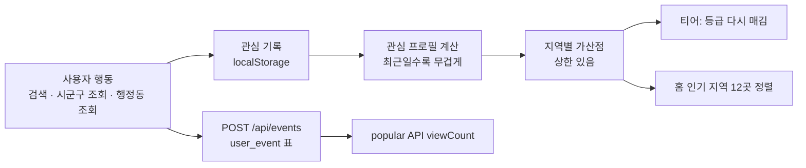

# 개인화 랭킹 설계 (관심 가중치)

2026-11-15 · 웹(workation-web) + 백엔드(workation-backend) · 화면 W-01 홈 인기 지역, W-02 티어

## 1. 왜 만드는가

지금 랭킹은 모두에게 같다. 서버가 지표별 백분위 점수를 주고, 웹이 프리셋 가중치로
`composite()` 를 계산해 정렬·등급을 매긴다. 사용자가 무엇에 관심을 보였는지는 반영되지 않는다.

목표는 **사용자가 지금 관심 있는 쪽이 화면에 자연스럽게 더 드러나게** 하는 것이다. 유튜브
추천처럼 사용자가 따로 설정하거나 알아차리지 않아도, 최근 검색·조회한 성격과 지역이 티어표와
홈 인기 지역(검색 결과 포함)에서 더 위에, 더 높은 등급으로 보인다.

발표 시연에서도 쓰지만, **시연용 장치가 아니라 실제 서비스 동작**으로 만든다 (사용자 결정).

## 2. 목표 · 비목표 · 하지 말아야 할 것

**목표**

- 사용자 행동(검색, 시군구 상세 조회, 행정동 상세 조회)을 관심 프로필로 누적한다.
- 관심 프로필로 지역마다 가산점을 계산해 기존 종합 점수에 더한다.
- 반영 화면
  - W-02 티어(`/tier`, 시군구·행정동 두 보기): 가산점을 더한 점수로 **등급까지 다시 매긴다** (사용자 결정).
  - W-01 홈 인기 지역 12곳(검색 결과 정렬이 이 목록이다): 가산점을 더한 점수로 정렬하고 등급·순위 배지도 따른다.
  - **같은 등급·순위 계산을 쓰는 모든 화면을 개인 점수로 통일한다** (사용자 결정): W-03 시군구 상세의
    "S등급 · N위"(`region/rank.ts`), W-04 행정동 상세(`DongPlanCard`, `DongScoreCard`, `DongProfilePage`),
    W-08 마이페이지 즐겨찾기 카드(`me/components/FavoriteRegions.tsx`), W-01 히트맵 색(`heatmap/heat.ts`).
    한 사용자 안에서는 어느 화면에서 보든 점수·등급·순위가 맞아야 알아차리지 못하기 때문이다.
  - W-05 비교(`compare/rank.ts`)는 **바꾸지 않는다** (계획 작성 중 확인). 종합 점수가 아니라 지표
    하나(동네 조용함)의 데이터 순위라서, 세부 지표를 바꾸지 않는다는 8절 판단과 같은 경우다.
- 행동 기록을 서버에도 쌓는다 (방법 3, 사용자 결정). 로그인이 생기면 기기 간 연결과 서버 개인화의 바탕이 된다.
- 쌓인 시군구 조회 기록으로 지금 0 으로 고정된 `viewCount` 를 채운다 (설계자 판단, 방법 3 의 이점으로 제시했던 것).

**비목표**

- 로그인. 다음 작업으로 따로 한다 (사용자 결정, 순서: 개인화 랭킹 → 로그인). 이번에는 `user_id` 칸만 비워 둔다.
- 서버에서 개인화 점수를 계산하는 것. 이번에는 브라우저가 계산하고 서버는 기록만 받는다.
- 다른 사용자 행동을 합친 집계 랭킹("요즘 많이 찾는 곳"). `viewCount` 채우기 외에는 하지 않는다.
- 또래 밀도 연령 반영 (인계 문서 6장, 로그인 뒤).
- 지도 탐색(W-09) 화면 순서 변경. 탐색은 신호를 주기만 한다.

**하지 말아야 할 것 (기술적으로 돌아가도 실패)**

- "추천", "관심 반영" 같은 표시나 켜고 끄는 버튼을 화면에 두는 것. 드러나지 않아야 한다 (사용자 결정).
- 관심 하나 때문에 데이터 점수가 무의미해지는 것. 예: 한 번 본 지역이 C 에서 S 로 뛰는 것. 가산점에 상한을 둔다.
- 사용자가 직접 고른 조건을 개인화가 덮는 것. 지형 필터·시군구 필터는 그대로 거르고, 직접 고른 프리셋·지표는 기본 점수로 그대로 쓴다.
- 행동 기록 전송 실패나 저장소 차단 때문에 화면이 깨지거나 느려지는 것.

## 3. 제약

- 로그인 없음. 사용자 구분은 브라우저마다 만드는 익명 ID 뿐이다.
- 공유 Supabase 의 스키마 변경은 SQL 파일(`db/migrations/YYYYMMDD_설명.sql`)과 PR 로 먼저 만들고, 적용은 사용자가 직접 한다 (팀 규칙, 권한 정책).
- Supabase Session pooler 동시 연결 15개 한도. 기록 API 는 가볍게(한 요청에 쓰기 한 번) 만든다.
- 백엔드 Django 모델은 `managed = False`, 스키마 기준은 `db/schema.sql`.
- 웹은 두 API 계약 중 `/api/...`(webapi 앱)을 쓴다. 새 API 도 이쪽에 둔다.
- mock 모드(`VITE_USE_MOCK=true`)에서도 개인화는 동작해야 한다 (기록 전송만 생략).

## 4. 방법 비교

| 방법 | 내용 | 장점 | 단점 |
| --- | --- | --- | --- |
| 1. 브라우저에서 기록·계산 | localStorage 에 기록, 화면에서 계산 | 서버·DB 변경 없음, 즉시 반응 | 기기 바뀌면 초기화, 팀이 데이터를 못 봄 |
| 2. 서버에서 기록·계산 | 익명 ID 로 서버에 쌓고 서버가 개인 점수 계산 | 로그인 후 기기 간 연결, 데이터 남음 | 공유 DB 변경, 연결 한도, 캐시 불가, 작업량 2~3배 |
| **3. 계산은 브라우저, 기록은 서버에도** | 1 과 같이 반영하고 기록을 서버에도 보냄 | 즉시 반응 + 데이터 축적, 로그인 뒤 서버 이전 쉬움 | DB 표 추가 필요 |

**선택: 방법 3** (사용자 결정). 랭킹 계산이 이미 모두 브라우저에 있고, 로그인이 생기면 쌓인
기록을 `user_id` 에 연결해 서버 개인화로 옮길 수 있기 때문이다.

## 5. 설계

### 5-1. 흐름

### 5-2. 신호 (무엇을 관심으로 보는가)

| 신호 | 언제 | 담는 것 |
| --- | --- | --- |
| `search` | 홈 검색 실행 후 파싱 결과를 받았을 때 | 질문 문장, 파싱 결과의 `preset` · `terrain` (그리고 결과에 지역이 있으면 지역) |
| `region_view` | W-03 시군구 상세 진입 (지금 `recordRegionView` 를 부르는 자리) | 시군구 코드 |
| `dong_view` | 행정동 상세 진입, 지도 탐색(W-09)에서 동 패널을 열 때 | 행정동 코드(adm_code) |

- 같은 대상을 짧은 시간에 반복해 여는 것(새로고침, 뒤로 가기)은 한 번으로 친다. 간격은 만드는 사람이 정한다 (예: 30분).
- 행정동 조회는 그 행정동과 소속 시군구 양쪽 관심으로 친다.

### 5-3. 관심 프로필

최근 기록(브라우저에 최대 수백 건, 오래된 것부터 버림)에서 세 갈래 관심을 계산한다. 각 기록의
무게는 **시간이 지날수록 줄어든다** (반감기 방식, 기본값 예: 7일). 현재 관심이 드러나야 하기 때문이다.

1. **지표 관심**: 검색의 프리셋(quiet·lively)을 `PRESET_WEIGHTS` 로 지표 가중치로 바꿔 누적한다.
   시군구·행정동 조회도, 그 지역에서 점수가 높은 지표 쪽으로 관심을 조금 더한다
   (조용함이 S 인 곳을 자주 보면 조용함 관심이 커진다).
2. **지형 관심**: 검색의 terrain(coast·mountain·city)과 조회한 지역의 `terrain` 을 누적한다.
3. **지역 관심**: 조회한 시군구·행정동 자체.

### 5-4. 가산점과 적용

- 지역마다 `가산점 = 상한 × (지표 일치도 · 지형 일치도 · 지역 관심의 가중 조합)`.
  - 지표 일치도: 관심 지표 가중치로 계산한 그 지역 `composite` (0~100 → 0~1).
  - 지형 일치도: 관심 지형과 그 지역 `terrain` 의 겹침.
  - 지역 관심: 그 지역(행정동 보기에서는 그 동과 소속 시군구)을 직접 본 정도.
- **상한**: 가산점은 100점 척도에서 최대 15점 정도로 시작한다. 한 단계 정도 등급이 움직일 수 있고, C 가 S 로 뛰지는 않는 크기다. 세 갈래 비중과 정확한 상한은 만드는 사람이 실제 데이터로 조정한다.
- **개인 점수** = 기본 점수(사용자가 고른 프리셋·지표로 계산한 지금의 `composite`) + 가산점.
- 기록이 없으면 가산점은 0 이다. 처음 온 사용자의 화면은 지금과 똑같다.

적용 위치

| 화면 | 지금 | 바꾼 뒤 |
| --- | --- | --- |
| W-02 티어 `buildTiers` | 기본 점수 → `toGrades` → 등급별 정렬 | 종합 보기(`tab === 'value'`)만 개인 점수 → 등급 → 정렬. 지표 하나 보기(`tab === 'metric'`)는 데이터 값이라 그대로 (계획 작성 중 정정: 가산점은 종합 점수에만 붙는다는 아래 판단과 맞춤. 그래야 W-04 동네 조용함 순위와 W-05 비교가 어긋나지 않는다) |
| W-01 홈 `sortPopular` · 카드 | 정렬 기준이 점수일 때 `composite`, 카드 등급·배지도 기본 점수 | 정렬·카드 점수·등급·순위 배지 모두 개인 점수 |
| W-01 히트맵 · W-03 · W-04 · W-08 | 기본 점수로 등급·순위 | 개인 점수로 등급·순위 |

- **종합 점수 숫자도 개인 점수로 보인다** (사용자 결정, 모든 화면 통일). 그래야 같은 등급 안에서
  숫자가 내림차순이고 "점수 1위" 카드가 실제로 가장 높은 숫자를 가진다.
- 지표별 세부 점수·세부 등급 칩(조용함 S 등)은 데이터 값이라 **바꾸지 않는다** (설계자 판단).
  가산점은 종합 점수에만 붙는다.
- 상세 화면(W-03, W-04)은 들어온 순간의 기록으로 점수·순위를 고정한다 (계획 검토 중 결정). 그 화면에
  들어오며 생긴 조회 기록 때문에 보는 도중 자기 순위가 바뀌면 깜빡임으로 드러나기 때문이다. 새 기록은
  다음에 여는 화면부터 반영된다. 상세에서 다른 상세로 바로 이동해도(예: 행정동 A → B) 그 이동이
  "다음에 여는 화면" 이라 그 시점 기록으로 다시 고정한다.
- 개인 점수 계산은 한 곳(예: 가산점 맵을 주는 훅)에서 하고 위 화면들이 같은 값을 받아 쓴다.
  화면마다 따로 계산하면 다시 어긋나기 때문이다.
- 지형 필터·시군구 필터는 지금처럼 등급 계산 뒤(또는 앞) 그대로 거른다. 개인화는 걸러진 목록을 바꾸지 않는다.

### 5-5. 브라우저 저장

- `localStorage` 에 익명 ID(`crypto.randomUUID()`)와 최근 기록을 둔다. 읽기·쓰기는 모두 try/catch, 실패하면 개인화 없이 지금 화면.
- 기록 형식은 서버로 보내는 이벤트와 같게 해서, 로그인 뒤 서버 기록으로 바꿔 끼우기 쉽게 한다.
- 관심 계산은 순수 함수 모듈 하나로 둔다 (기록 배열 + 현재 시각 → 프로필 → 지역별 가산점). 단위 테스트 대상.

### 5-6. 서버 기록

**표 `user_event`** (새 migration, 사용자가 Supabase 에 적용)

| 컬럼 | 타입 | 설명 |
| --- | --- | --- |
| `id` | bigserial PK | |
| `anon_id` | uuid not null | 브라우저 익명 ID |
| `user_id` | `app_user` 참조, null 허용 | 로그인 작업에서 채운다 |
| `kind` | text, CHECK `search` · `region_view` · `dong_view` | |
| `target` | text null | 시군구 코드 또는 행정동 코드 |
| `payload` | jsonb null | search 의 질문 문장 · 파싱 결과 |
| `created_at` | timestamptz default now() | |

- 인덱스: (`anon_id`, `created_at`), (`kind`, `target`, `created_at`).
- RLS 켜기 (다른 표와 같게). 보관 기간은 정하지 않는다 (아래 열린 질문).

**API**

- `POST /api/events` : 본문 `{anonId, kind, target?, payload?}`. 204. 잘못된 값은 400. IP 당 throttle (기존 explore ask 처럼 캐시 기반).
- 기존 `POST /api/regions/{id}/view`(지금은 받기만 함): 웹이 새 API 로 옮긴 뒤 지우거나, 익명 ID 없이 들어오면 `region_view` 로 기록한다. 만드는 사람이 정한다.
- `GET /api/regions/popular` 의 `viewCount`: 최근 30일 `region_view` 의 서로 다른 `anon_id` 수 (웹 타입 주석의 "최근 30일" 과 맞춤).
- 전송은 응답을 기다리지 않는다 (`sendBeacon` 또는 `fetch keepalive`). 실패는 무시.

### 5-7. 로그인과의 연결 (다음 작업에서)

- 로그인하면 그 브라우저의 `anon_id` 기록에 `user_id` 를 채운다.
- 그 뒤 다른 기기에서는 서버 기록을 받아 브라우저 기록을 채우거나, 서버가 프로필을 계산한다. 이번 작업은 이 연결이 가능하도록 표 구조와 기록 형식만 맞춘다.

## 6. 검증

- 관심 계산 모듈 단위 테스트: 기록 없음 → 가산점 0, 오래된 기록의 무게 감소, 상한 넘지 않음, 반복 조회 중복 제거.
- `buildTiers` · `sortPopular` 테스트: 같은 입력에 가산점을 주면 등급·순서가 바뀌고, 가산점 0 이면 지금과 같다.
- E2E (mock): 홈에서 "바닷가에서 조용히" 검색 → 바닷가 시군구 두세 곳 조회 → `/tier` 와 홈 목록에서 바닷가 지역이 기록 전보다 위로 온다.
- 백엔드: `POST /api/events` 검증·throttle, `viewCount` 집계 테스트.
- 실환경: 로컬 백엔드 + Supabase(표 적용 뒤)에서 기록이 쌓이고 `viewCount` 가 바뀌는지.

## 7. 만드는 사람에게 맡기는 것

- 반감기, 상한, 세 갈래 비중, 반복 조회 간격, 브라우저 기록 최대 개수의 정확한 값.
- 이벤트 전송 방식(`sendBeacon` / `fetch keepalive`), 묶어서 보낼지.
- 기존 `/view` API 정리 방식.
- 모듈·파일 배치, 상태 관리(React Query 캐시와 어떻게 맞물릴지).

## 8. 검토 뒤 정한 것 (설계자 판단)

- **조회 기록에 점수 스냅숏을 담는다.** `region_view` · `dong_view` 기록의 `payload` 에 그 순간 화면이
  가진 그 지역의 지표 점수 5개와 `terrain`, 기준 달을 함께 저장한다. 지표 관심은 이 스냅숏으로
  계산한다. 계산할 때 예전에 본 행정동 점수를 다시 받아 올 필요가 없고, 보는 달을 바꿔도 관심이
  흔들리지 않기 때문이다. 따라서 `payload` 는 search 전용이 아니다.
- **"C 가 S 로 뛰지 않는다" 는 등급 제한으로 보장한다.** `toGrades` 는 순위 비율로 등급을 나눠
  12곳처럼 점수가 몰리면 15점 상한만으로는 두 단계 이상 오를 수 있다. 그래서 개인 등급은
  기본 등급과 같거나 **최대 한 단계 위**로 묶는다. 관심 없는 지역이 남에게 밀려 등급이
  떨어지는 일은 없다. 그 대신 등급별 개수가 정확한 사분위에서 조금 벗어날 수 있다.
  정렬은 (개인 등급, 개인 점수) 순으로 해서 등급과 순서가 어긋나지 않게 한다.
- **검색 기록은 `user_event` 하나에만 남긴다.** `nl_search_log` 는 파싱 품질 검증용으로 남겨 두고
  이번에는 쓰지 않는다. 웹이 파싱 결과를 받은 뒤 `search` 이벤트를 보낸다 (서버 파싱 단계에는
  익명 ID 가 없기 때문이다).
- **공유 링크로 들어와 URL 의 `q` 를 자동 파싱한 경우는 관심으로 치지 않는다.** 사용자가 직접
  검색을 실행했을 때만 기록한다. 다른 사람의 검색이 내 관심이 되면 안 되기 때문이다.

## 9. 열린 질문

없음. 검토에서 나온 "적용 범위" 질문은 모든 화면 통일로 정했다 (2026-11-15 사용자 결정).

- 남는 위험: 서로 다른 사람이 같은 지역의 점수·등급을 다르게 본다. 함께 화면을 놓고 비교하거나
  공유 링크를 열면 차이가 드러날 수 있다. 개인화를 택한 이상 받아들이는 결과로 둔다.
